<div align="center">

<h1>Shan Hefu</h1>

<picture>
  <source media="(prefers-color-scheme: dark)" srcset="https://readme-typing-svg.demolab.com?font=JetBrains+Mono&amp;weight=500&amp;size=19&amp;duration=3200&amp;pause=1800&amp;color=79C0FF&amp;center=true&amp;vCenter=true&amp;width=450&amp;height=42&amp;lines=Computer+Vision;Self-supervised+Learning;Research+Engineering">
  <source media="(prefers-color-scheme: light)" srcset="https://readme-typing-svg.demolab.com?font=JetBrains+Mono&amp;weight=500&amp;size=19&amp;duration=3200&amp;pause=1800&amp;color=0969DA&amp;center=true&amp;vCenter=true&amp;width=450&amp;height=42&amp;lines=Computer+Vision;Self-supervised+Learning;Research+Engineering">
  
</picture>

M.S. in Computer Science · Sophia University · Tokyo, Japan

<a href="https://shengruduzhou.github.io/"></a>
<a href="https://shanhefu-portfolio.vercel.app/"></a>
<a href="https://shengruduzhou.github.io/assets/CV.pdf"></a>
<a href="https://shengruduzhou.github.io/assets/CV_CN.pdf"></a>
<a href="https://linkedin.com/in/hefu-shan-054b24361/"></a>
<a href="mailto:shanhefu@gmail.com"></a>

</div>

## Research & engineering

I study visual representation learning for panoramic images, with an emphasis on spherical geometry and self-supervised learning. My work explores how learned representations transfer to segmentation, depth estimation and surface normal estimation.

| Research | Selected software |
| :--- | :--- |
| Panoramic computer vision<br>Self-supervised representation learning<br>Dense visual prediction | **[FormulaForge](https://github.com/shengruduzhou/FormulaForge)** — mathematical analysis for research papers<br>**[QuantAgent](https://github.com/shengruduzhou/QuantAgent)** — point-in-time quantitative research<br>**[Atlas](https://shengruduzhou.github.io/labs/atlas/)** — interactive spherical geometry |

## Technical stack

**Research** &nbsp;   

**Engineering** &nbsp;    

## GitHub metrics

<!-- METRICS:DETAILS:START -->
### Isometric Calendar


### Personal Website

<a href="https://shengruduzhou.github.io/"></a>

### GitHub Profile Trophies

<picture>
  <source media="(prefers-color-scheme: dark)" srcset="./assets/metrics/trophy-dark.svg">
  <source media="(prefers-color-scheme: light)" srcset="./assets/metrics/trophy-light.svg">
  
</picture>
<!-- METRICS:DETAILS:END -->

<details open>
<summary>Account overview · GitHub Metrics</summary>

<!-- METRICS:START -->
<p align="center">
  
</p>

<sub>Public-data coverage · Generated by <a href="https://github.com/lowlighter/metrics">lowlighter/metrics</a> · <a href="./.github/workflows/metrics.yml">Workflow</a></sub>
<!-- METRICS:END -->

</details>

<details>
<summary>Development activity · WakaTime & contribution animation</summary>

<br />

<picture>
  <source media="(prefers-color-scheme: dark)" srcset="./assets/contribution-snake-dark.svg">
  <source media="(prefers-color-scheme: light)" srcset="./assets/contribution-snake.svg">
  
</picture>

<!--START_SECTION:waka-->

```txt
Total Time: 87 hrs 12 mins

Text       47 hrs 21 mins  ███████████▓░░░░░░░░░░░░░   46.21 %
Markdown   39 hrs 41 mins  █████████▓░░░░░░░░░░░░░░░   38.73 %
Other      15 hrs 16 mins  ███▓░░░░░░░░░░░░░░░░░░░░░   14.91 %
JSON       7 mins          ░░░░░░░░░░░░░░░░░░░░░░░░░   00.12 %
TeX        2 mins          ░░░░░░░░░░░░░░░░░░░░░░░░░   00.03 %
```

<!--END_SECTION:waka-->

</details>

<sub>Powered by [Metrics](https://github.com/lowlighter/metrics), [Readme Typing SVG](https://github.com/DenverCoder1/readme-typing-svg), [GitHub Profile Trophy](https://github.com/ryo-ma/github-profile-trophy), and [Shields.io](https://shields.io/).</sub>
