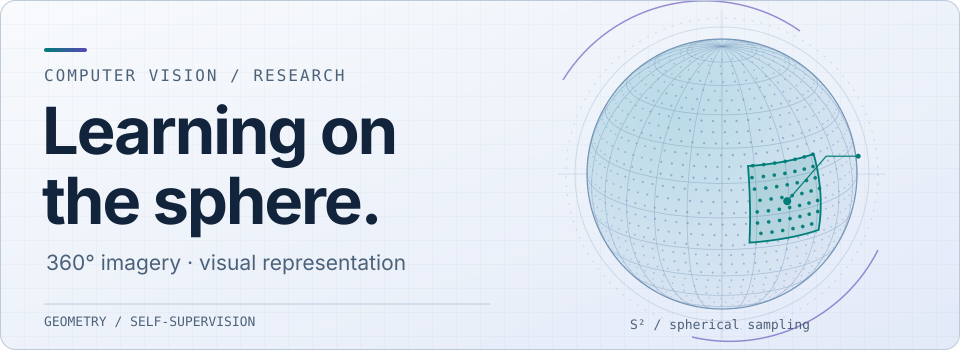
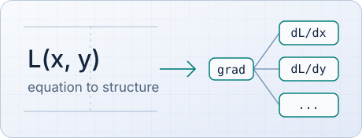
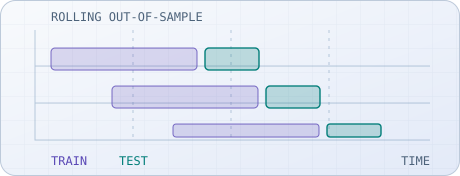

# Shan Hefu

<picture>
  <source media="(prefers-color-scheme: dark)" srcset="./assets/spectral/hero-dark.svg">
  <source media="(prefers-color-scheme: light)" srcset="./assets/spectral/hero-light.svg">
  
</picture>

I'm a master's student in Computer Science at Sophia University, Tokyo. I study self-supervised representation learning for panoramic images and build software for research.

[Website](https://shengruduzhou.github.io/) · [CV (EN)](https://shengruduzhou.github.io/assets/CV.pdf) · [CV (中文)](https://shengruduzhou.github.io/assets/CV_CN.pdf) · [Portfolio](https://shanhefu-portfolio.vercel.app/) · [LinkedIn](https://linkedin.com/in/hefu-shan-054b24361/) · [Email](mailto:shanhefu@gmail.com)

## Research

Most vision models learn from flat, perspective images. I study what changes when the camera sees the entire sphere: how to encode geometry, learn from unlabelled panoramas, and transfer the resulting representations to segmentation, depth and surface normal estimation.

`360° Vision` · `Self-supervised learning` · `Dense prediction`

## Selected work

<table>
<tr>
<td width="50%" valign="top">
<a href="https://github.com/shengruduzhou/FormulaForge">
<picture>
  <source media="(prefers-color-scheme: dark)" srcset="./assets/spectral/formula-dark.svg">
  <source media="(prefers-color-scheme: light)" srcset="./assets/spectral/formula-light.svg">
  
</picture>
</a>
<h3><a href="https://github.com/shengruduzhou/FormulaForge">FormulaForge</a></h3>
A workspace for understanding equations in research papers, with a local parser, screenshot input and optional multimodal model analysis.
</td>
<td width="50%" valign="top">
<a href="https://github.com/shengruduzhou/QuantAgent">
<picture>
  <source media="(prefers-color-scheme: dark)" srcset="./assets/spectral/quant-dark.svg">
  <source media="(prefers-color-scheme: light)" srcset="./assets/spectral/quant-light.svg">
  
</picture>
</a>
<h3><a href="https://github.com/shengruduzhou/QuantAgent">QuantAgent</a></h3>
Point-in-time research for Chinese equities, with rolling out-of-sample evaluation, transaction costs and portfolio constraints. Live trading is disabled by default.
</td>
</tr>
</table>

**[Notes & Projects](https://shengruduzhou.github.io/)** — Technical writing, research notes and project documentation. [Site source](https://github.com/shengruduzhou/shengruduzhou.github.io).

## Tools

**Research** — Python, PyTorch, OpenCV  
**Software** — TypeScript, React, FastAPI

<details>
<summary>Development activity</summary>

<br>

<picture>
  <source media="(prefers-color-scheme: dark)" srcset="./assets/contribution-snake-dark.svg">
  <source media="(prefers-color-scheme: light)" srcset="./assets/contribution-snake.svg">
  
</picture>

[3D contribution calendar](./profile-3d-contrib/profile-night-rainbow.svg)

<!--START_SECTION:waka-->

```txt
Total Time: 87 hrs 12 mins

Text       47 hrs 21 mins  ███████████▓░░░░░░░░░░░░░   46.21 %
Markdown   39 hrs 41 mins  █████████▓░░░░░░░░░░░░░░░   38.73 %
Other      15 hrs 16 mins  ███▓░░░░░░░░░░░░░░░░░░░░░   14.91 %
JSON       7 mins          ░░░░░░░░░░░░░░░░░░░░░░░░░   00.12 %
TeX        2 mins          ░░░░░░░░░░░░░░░░░░░░░░░░░   00.03 %
```

<!--END_SECTION:waka-->

</details>
