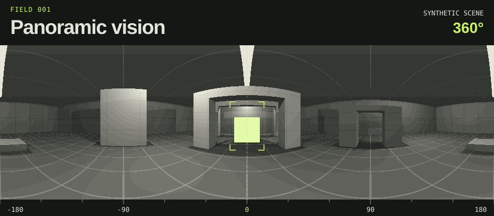

# Shan Hefu

**Computer vision · Machine learning · Research engineering**

M.S. student in Computer Science at Sophia University, Tokyo. I study how visual representations can be learned from unlabelled panoramic images.

[Website](https://shengruduzhou.github.io/) · [Portfolio](https://shanhefu-portfolio.vercel.app/) · [CV (EN)](https://shengruduzhou.github.io/assets/CV.pdf) · [CV (中文)](https://shengruduzhou.github.io/assets/CV_CN.pdf) · [LinkedIn](https://linkedin.com/in/hefu-shan-054b24361/) · [Email](mailto:shanhefu@gmail.com)



<sub>FIELD 001 — A synthetic 360° horizontal view, rendered from a single camera centre. <a href="./scripts/generate-field.cjs">Source</a>.</sub>

## Research

I work on self-supervised learning for spherical imagery, with a focus on geometric representation and transfer to semantic segmentation, depth estimation and surface normal estimation.

## Selected work

### [FormulaForge](https://github.com/shengruduzhou/FormulaForge)

A workspace for reading the mathematics in research papers. It combines deterministic parsing of LaTeX with optional multimodal analysis of equations and screenshots.

### [QuantAgent](https://github.com/shengruduzhou/QuantAgent)

A point-in-time research system for Chinese equities. It supports rolling out-of-sample evaluation, transaction-cost modelling and auditable portfolio constraints. Live trading is disabled by default.

### [Notes & Projects](https://shengruduzhou.github.io/)

Research notes, technical writing and project documentation. [Site source](https://github.com/shengruduzhou/shengruduzhou.github.io).

---

**Research:** Python, PyTorch, OpenCV  
**Engineering:** TypeScript, React, FastAPI

<details>
<summary>Development activity</summary>

<br>

<picture>
  <source media="(prefers-color-scheme: dark)" srcset="./assets/contribution-snake-dark.svg">
  <source media="(prefers-color-scheme: light)" srcset="./assets/contribution-snake.svg">
  
</picture>

[3D contribution calendar](./profile-3d-contrib/profile-night-rainbow.svg)

<!--START_SECTION:waka-->

```txt
Total Time: 87 hrs 12 mins

Text       47 hrs 21 mins  ███████████▓░░░░░░░░░░░░░   46.21 %
Markdown   39 hrs 41 mins  █████████▓░░░░░░░░░░░░░░░   38.73 %
Other      15 hrs 16 mins  ███▓░░░░░░░░░░░░░░░░░░░░░   14.91 %
JSON       7 mins          ░░░░░░░░░░░░░░░░░░░░░░░░░   00.12 %
TeX        2 mins          ░░░░░░░░░░░░░░░░░░░░░░░░░   00.03 %
```

<!--END_SECTION:waka-->

</details>
