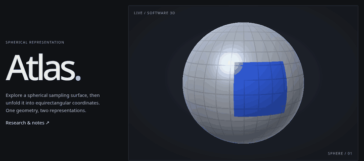

# Shan Hefu

Computer vision · Self-supervised learning · Research engineering

I'm a computer science master's student at Sophia University, Tokyo. I study how models learn visual representations from unlabelled panoramic images.

[Website](https://shengruduzhou.github.io/) · [Portfolio](https://shanhefu-portfolio.vercel.app/) · [CV (EN)](https://shengruduzhou.github.io/assets/CV.pdf) · [CV (中文)](https://shengruduzhou.github.io/assets/CV_CN.pdf) · [LinkedIn](https://linkedin.com/in/hefu-shan-054b24361/) · [Email](mailto:shanhefu@gmail.com)

<a href="https://shengruduzhou.github.io/labs/atlas/">
  
</a>

**[Explore Atlas ↗](https://shengruduzhou.github.io/labs/atlas/)** — An interactive 3D study of spherical geometry. Rotate the surface, zoom in, and unfold it into equirectangular coordinates. [Source](https://github.com/shengruduzhou/shengruduzhou.github.io/tree/main/labs/atlas).

## Selected work

| Project | Focus |
| :--- | :--- |
| **[FormulaForge](https://github.com/shengruduzhou/FormulaForge)** | Reading mathematics in research papers through formula parsing and optional multimodal analysis. |
| **[QuantAgent](https://github.com/shengruduzhou/QuantAgent)** | Point-in-time research for Chinese equities, rolling out-of-sample evaluation and portfolio constraints. Live trading is disabled by default. |
| **[Notes & Projects](https://shengruduzhou.github.io/)** | Research notes, technical writing and project documentation. |

## Research

Self-supervised representation learning for 360° imagery, spherical geometry, and transfer to semantic segmentation, depth and surface normal estimation.

Python, PyTorch and OpenCV for research; TypeScript, React and FastAPI for software engineering.

<details>
<summary>Development activity</summary>

<br>

<picture>
  <source media="(prefers-color-scheme: dark)" srcset="./assets/contribution-snake-dark.svg">
  <source media="(prefers-color-scheme: light)" srcset="./assets/contribution-snake.svg">
  
</picture>

[3D contribution calendar](./profile-3d-contrib/profile-night-rainbow.svg)

<!--START_SECTION:waka-->

```txt
Total Time: 87 hrs 12 mins

Text       47 hrs 21 mins  ███████████▓░░░░░░░░░░░░░   46.21 %
Markdown   39 hrs 41 mins  █████████▓░░░░░░░░░░░░░░░   38.73 %
Other      15 hrs 16 mins  ███▓░░░░░░░░░░░░░░░░░░░░░   14.91 %
JSON       7 mins          ░░░░░░░░░░░░░░░░░░░░░░░░░   00.12 %
TeX        2 mins          ░░░░░░░░░░░░░░░░░░░░░░░░░   00.03 %
```

<!--END_SECTION:waka-->

</details>

