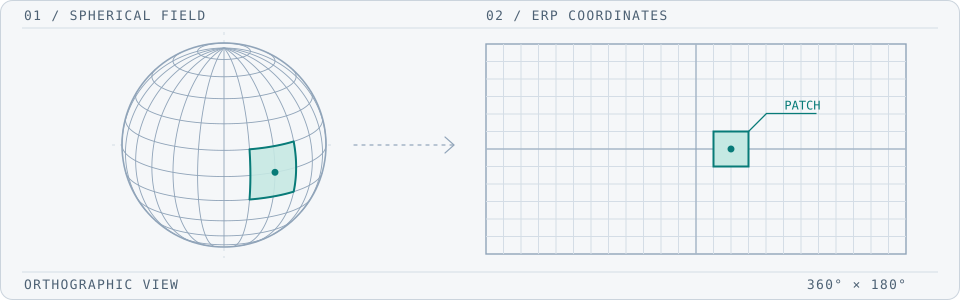

# Shan Hefu

**Computer vision · Machine learning · Software engineering**

I'm a master's student in Computer Science at Sophia University, Tokyo. My research focuses on visual representation learning for panoramic images.

[Website](https://shengruduzhou.github.io/) · [CV (EN)](https://shengruduzhou.github.io/assets/CV.pdf) · [CV (中文)](https://shengruduzhou.github.io/assets/CV_CN.pdf) · [Portfolio](https://shanhefu-portfolio.vercel.app/) · [LinkedIn](https://linkedin.com/in/hefu-shan-054b24361/) · [Email](mailto:shanhefu@gmail.com)

<picture>
  <source media="(prefers-color-scheme: dark)" srcset="./assets/sphere-dark.svg">
  <source media="(prefers-color-scheme: light)" srcset="./assets/sphere-light.svg">
  
</picture>

## Research

I'm interested in how to learn visual features from 360° images without annotations, how spherical geometry changes the learning problem, and how those representations transfer to dense visual prediction.

Outside research, I build software for reading papers and testing quantitative investment strategies.

## Selected projects

**[FormulaForge](https://github.com/shengruduzhou/FormulaForge)** — An academic formula-analysis workspace. Explore equations from LaTeX or paper screenshots using a local parser and optional multimodal LLM analysis.

**[QuantAgent](https://github.com/shengruduzhou/QuantAgent)** — A point-in-time research system for Chinese equities, with out-of-sample evaluation, transaction-cost modelling and auditable portfolio constraints. Live trading is disabled by default.

**[Notes & Projects](https://shengruduzhou.github.io/)** — My personal site for technical writing, research notes and project documentation. [Source](https://github.com/shengruduzhou/shengruduzhou.github.io).

## Tools

Python, PyTorch and OpenCV for vision research; TypeScript, React and FastAPI for application development.

<details>
<summary>Development activity</summary>

<br>

<picture>
  <source media="(prefers-color-scheme: dark)" srcset="./assets/contribution-snake-dark.svg">
  <source media="(prefers-color-scheme: light)" srcset="./assets/contribution-snake.svg">
  
</picture>

[3D contribution calendar](./profile-3d-contrib/profile-night-rainbow.svg)

<!--START_SECTION:waka-->

```txt
Total Time: 87 hrs 12 mins

Text       47 hrs 21 mins  ███████████▓░░░░░░░░░░░░░   46.21 %
Markdown   39 hrs 41 mins  █████████▓░░░░░░░░░░░░░░░   38.73 %
Other      15 hrs 16 mins  ███▓░░░░░░░░░░░░░░░░░░░░░   14.91 %
JSON       7 mins          ░░░░░░░░░░░░░░░░░░░░░░░░░   00.12 %
TeX        2 mins          ░░░░░░░░░░░░░░░░░░░░░░░░░   00.03 %
```

<!--END_SECTION:waka-->

</details>
